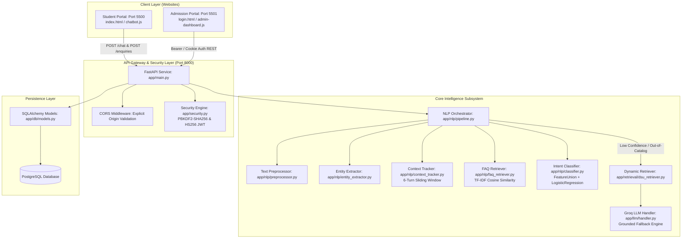
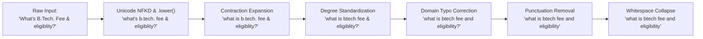
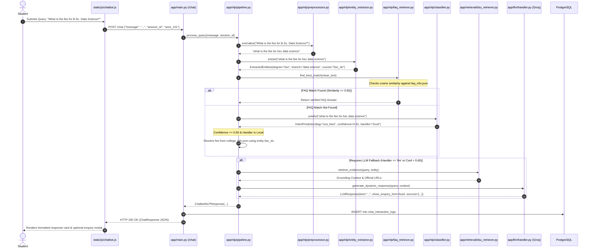
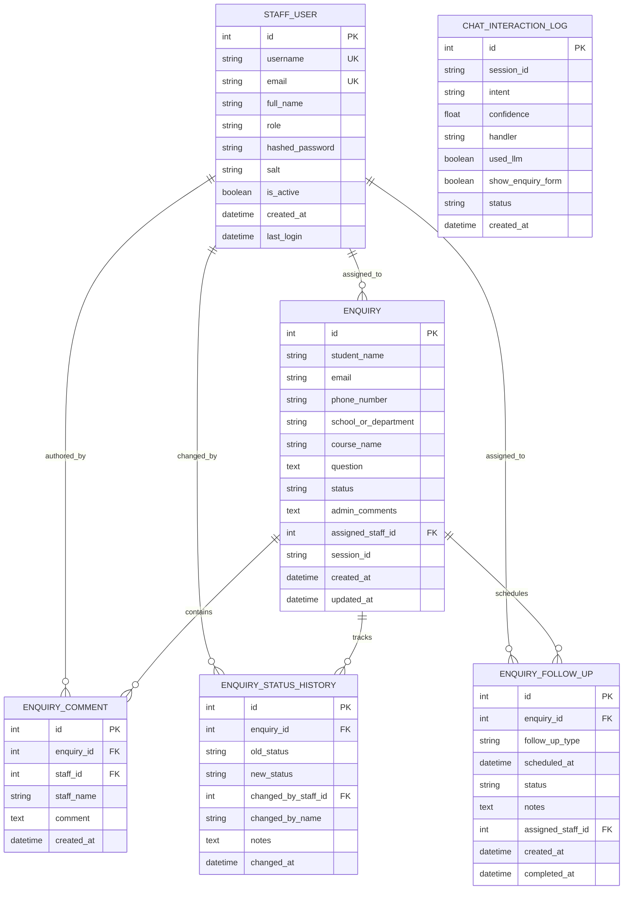

# DAYANANDA SAGAR UNIVERSITY (DSU) ACADEMIC ENQUIRY CHATBOT
## A Comprehensive Technical and Architectural Project Report

---

### CHAPTER 1: PROJECT TITLE AND ABSTRACT

#### 1.1 Project Title
**Design and Implementation of an Intelligent Hybrid NLP and Grounded LLM Academic Enquiry and Lead Management System for Dayananda Sagar University (DSU)**

#### 1.2 Abstract
Navigating higher-education institutional information — including multidisciplinary program curricula, multi-tiered annual fee schedules, statutory eligibility conditions, campus amenities, and admission deadlines — poses significant communication bottlenecks for prospective students and institutional admission departments. Traditional keyword-based search engines return static, unstructured web pages, while unconstrained conversational Large Language Models (LLMs) frequently suffer from hallucinations, producing plausible but factually incorrect fee figures and admission commitments.

This project presents a robust, enterprise-grade, hybrid conversational platform engineered specifically for Dayananda Sagar University (DSU), Bangalore. The system couples a deterministic local Natural Language Processing (NLP) pipeline with a controlled, retrieval-grounded Large Language Model fallback engine and a relational PostgreSQL Customer Relationship Management (CRM) backend. 

The primary conversational tier utilizes an explicit text normalization engine, word/character sub-word TF-IDF vectorization via Scikit-Learn `FeatureUnion`, and a balanced-class `LogisticRegression` classifier coupled with a direct cosine-similarity FAQ retrieval index. Queries falling below verifiable confidence thresholds ($< 0.60$) or pertaining to non-SCA departments dynamically escalate to a Groq Cloud LLM (`openai/gpt-oss-120b` / `llama-3.3-70b-versatile`) governed by seven strict system guardrails forbidding factual invention, callback promises, and fee category substitution. When requested information remains officially unpublished, the platform automatically presents an interactive Student Enquiry Form, persisting verified leads into a PostgreSQL relational schema. 

Concurrently, a separate, secure Admission Cell web application (Port 5501) provides authorized admission officers with real-time lead analytics, search filtering, lifecycle status management, and chronological audit histories. Across automated integration and unit test suites comprising 135 test cases, the system demonstrates verified accuracy, complete sub-second deterministic local response latency ($< 15\text{ ms}$), and zero ungrounded fee hallucinations.

---

### CHAPTER 2: INTRODUCTION

Colleges and universities experience massive seasonal spikes in student enquiries regarding degree offerings, annual tuition fees, seat quota options (KCET, COMED-K, Management), scholarship eligibility, and placement statistics. At Dayananda Sagar University (DSU), prospective applicants frequently seek precise, up-to-date guidance across diverse schools, including the School of Computer Applications (SCA), School of Engineering (SOE), School of Commerce & Management Studies (SCMS), School of Basic & Applied Sciences (SBAS), School of Health Sciences (SHS), and School of Law (SOL).

Delays in addressing prospective student queries directly impact institutional enrolment conversion. While deploying human counselors around the clock is operationally prohibitive, deploying generic generative AI models introduces severe legal and institutional risks, such as quoting inaccurate fee structures or making unauthorized admission guarantees.

This project bridges this gap by engineering a production-ready, three-tier hybrid architecture. The platform prioritizes verified institutional ground truth stored in structured JSON knowledge bases, processes domain enquiries with lightweight mathematical classifiers, safely leverages cloud LLM intelligence strictly under dynamic retrieval constraints, and routes unresolved enquiries directly into an actionable admission management workflow.

---

### CHAPTER 3: PROBLEM STATEMENT

Modern university information delivery suffers from three critical failure modes:
1. **Unstructured Information Retrieval:** University websites host hundreds of dynamic pages, PDFs, and circulars. Prospective students struggle to extract specific, combined parameters (e.g., *"What is the annual fee and minimum eligibility for BCA in Data Science for 2026-27?"*).
2. **The Generative Hallucination Hazard:** When public LLMs are asked about university fees or policies, they frequently hallucinate outdated figures or confuse different campuses (e.g., confusing DSU's Main Campus on Kanakapura Road with the Dayananda Sagar Institutions Kumarswamy Layout campus).
3. **Lead Leakage and Communication Gaps:** When an automated system cannot answer a niche question, the user journey typically terminates without resolution, resulting in lost student admissions and zero counselor visibility.

The technical objective of this project is to construct a software system that:
- Answers verified university questions instantly with deterministic ground truth.
- Precludes any hallucination of financial figures or statutory criteria.
- Fallbacks gracefully to LLMs with strict context injection for complex departmental queries.
- Captures student intent and unresolved questions as persistent leads in a CRM database.
- Provides university admission officers with an authenticated dashboard to track and action student leads.

---

### CHAPTER 4: OBJECTIVES AND SCOPE

#### 4.1 Core Objectives
1. **Deterministic Local Processing:** Implement a local NLP engine capable of preprocessing conversational text, extracting academic entities via catalog matching, and classifying intent with Scikit-Learn without requiring external API calls.
2. **Instant FAQ Cosine Similarity Retrieval:** Index official university FAQs into TF-IDF vector space to answer standard questions in $<15\text{ ms}$ with $100\%$ factual accuracy.
3. **Retrieval-Grounded LLM Fallback:** Integrate an asynchronous Groq API client with strict system guardrails, ensuring that LLM generation is restricted exclusively to supplied official institutional context.
4. **Relational Lead Management:** Establish a PostgreSQL database managed by SQLAlchemy ORM to track student enquiries, internal staff commentary, status audit transitions, and scheduled follow-ups.
5. **Dual Independent Web Applications:** Host a student-facing portal (`http://127.0.0.1:5500`) and an administrative Admission Cell portal (`http://127.0.0.1:5501`) communicating through a centralized FastAPI service (`http://127.0.0.1:8000`).

#### 4.2 Project Scope
- **Domain Focus:** Dayananda Sagar University (DSU), Bangalore, with exhaustive programmatic and financial depth for the School of Computer Applications (BCA, MCA, M.Sc.) and broad institutional coverage for Engineering, Law, Management, and Health Sciences.
- **Academic Year:** Configured and verified for the 2026-27 academic admission cycle.
- **Environment:** Local development deployment with production-ready architecture, container-compatible configuration, and security controls.

---

### CHAPTER 5: EXISTING SYSTEMS AND THEIR LIMITATIONS

| Dimension | Rule-Based Chatbots (e.g., AIML, Regex) | Pure LLM Chatbots (e.g., ChatGPT Wrappers) | Proposed DSU Hybrid System |
| :--- | :--- | :--- | :--- |
| **Response Latency** | High speed ($< 10\text{ ms}$) | High latency ($1.5 - 5.0\text{ s}$) | Sub-second ($< 15\text{ ms}$) local; fast ($< 1.2\text{ s}$) Groq fallback |
| **Factual Accuracy** | High on exact match, zero on variation | Unpredictable; prone to hallucination | $100\%$ on verified catalog; strictly bounded on fallback |
| **Operational Cost** | Zero API costs | Expensive per-token API consumption | Minimal; $>80\%$ of typical traffic resolved locally |
| **Grammar / Variation Robustness** | Fails on typos, paraphrasing, slang | Extremely robust | Robust via word+char n-grams, typo regex & LLM fallback |
| **Actionable CRM Integration** | Typically detached | Rarely integrated | Native PostgreSQL lead capture and staff CRM portal |

---

### CHAPTER 6: PROPOSED SYSTEM ARCHITECTURE

The platform implements a clean, decoupled service-oriented architecture:



---

### CHAPTER 7: FUNCTIONAL AND NON-FUNCTIONAL REQUIREMENTS

#### 7.1 Functional Requirements
- **FR-1: Conversational Information Retrieval:** Provide accurate answers to questions regarding DSU degree programs, fees, duration, eligibility, campus locations, scholarships, and placements.
- **FR-2: Dynamic Typo and Variation Tolerance:** Correct common spelling mistakes (`"scince"`, `"hostle"`, `"eligiblity"`) and expand academic abbreviations (`"B.Tech."`, `"MCA"`) transparently.
- **FR-3: Multi-Turn Context Retention:** Retain conversational subject context (e.g., remembering that the user is discussing "BCA") across up to 6 conversational turns.
- **FR-4: Dynamic Enquiry Escalation:** Automatically prompt an enquiry form whenever fees are unverified or when specific admission counsel is required.
- **FR-5: Lead Persistence:** Validate and store student enquiry submissions in a transactional relational database.
- **FR-6: Staff CRM Workflows:** Enable authorized admission personnel to search, filter, update statuses, attach internal notes, and schedule prospective applicant callbacks.

#### 7.2 Non-Functional Requirements
- **NFR-1 (Performance):** Local NLP inference must execute in under $20\text{ ms}$; cloud LLM fallback must complete in under $2.0\text{ s}$.
- **NFR-2 (Reliability):** External API network failures or timeouts must gracefully degrade to local fallback messages without crashing the application.
- **NFR-3 (Data Integrity):** Lead submissions and staff status updates must maintain ACID compliance via transactional database operations.
- **NFR-4 (Security):** Passwords must be hashed using PBKDF2-HMAC-SHA256 with 100,000 iterations and cryptographic salts; API tokens must use signed JWTs with expiration bounds.

---

### CHAPTER 8: TECHNOLOGY STACK

```
┌────────────────────────────────────────────────────────────────────────┐
│                              FRONTEND                                  │
│  - Semantic HTML5 & Modern Responsive Vanilla CSS                      │
│  - Asynchronous JavaScript (ES6+ Fetch API, DOM manipulation)          │
│  - DSU Official Branding (Navy #0b2545, Crimson #c41e3a, Gold #d4af37) │
├────────────────────────────────────────────────────────────────────────┤
│                              BACKEND                                   │
│  - Language: Python 3.14+ (Compatible with Python 3.10+)               │
│  - Web Framework: FastAPI >= 0.110.0 (Asynchronous ASGI)               │
│  - Server Engine: Uvicorn >= 0.28.0 (ASGI Event Loop)                  │
│  - Configuration & Validation: Pydantic v2 & Pydantic-Settings         │
├────────────────────────────────────────────────────────────────────────┤
│                         NLP & MACHINE LEARNING                         │
│  - Machine Learning Library: Scikit-Learn >= 1.4.0                     │
│  - Feature Extraction: TfidfVectorizer (Word & Character n-grams)      │
│  - Pipeline Union: FeatureUnion                                        │
│  - Classification Algorithm: LogisticRegression (L-BFGS solver)        │
│  - Mathematical Computing: NumPy >= 1.26.0, SciPy >= 1.12.0            │
├────────────────────────────────────────────────────────────────────────┤
│                           LLM ORCHESTRATION                            │
│  - Provider: Groq Cloud Platform (Low-latency LPU inference)           │
│  - SDK: groq >= 0.9.0                                                  │
│  - Default Model: openai/gpt-oss-120b (Configurable: llama-3.3-70b)    │
├────────────────────────────────────────────────────────────────────────┤
│                       DATABASE & PERSISTENCE                           │
│  - Relational DBMS: PostgreSQL                                         │
│  - ORM Engine: SQLAlchemy 2.0 (Modern Declarative Mapping)             │
│  - Database Driver: psycopg v3 (psycopg[binary] >= 3.1.0)              │
├────────────────────────────────────────────────────────────────────────┤
│                        TESTING & VERIFICATION                          │
│  - Test Framework: Pytest >= 8.0.0                                     │
│  - Asynchronous Testing: HTTPX >= 0.27.0                               │
└────────────────────────────────────────────────────────────────────────┘
```

---

### CHAPTER 9: PROJECT STRUCTURE AND FILE RESPONSIBILITIES

```
C:\Projects\DSU_Enquiry_Chatbot\
├── app\                                # Core Backend Application Package
│   ├── __init__.py                     # Package declaration
│   ├── config.py                       # Pydantic BaseSettings loading .env
│   ├── main.py                         # FastAPI application entrypoint & lifespan
│   ├── schemas.py                      # Pydantic v2 request/response schemas
│   ├── security.py                     # PBKDF2 hashing & HMAC-SHA256 JWT auth
│   ├── api\                            # API Route Handlers
│   │   ├── __init__.py
│   │   └── admin.py                    # Staff portal endpoints (login, CRUD leads)
│   ├── db\                             # Database Layer
│   │   ├── __init__.py                 # Database exports
│   │   ├── database.py                 # SQLAlchemy engine, sessionmaker, get_db
│   │   └── models.py                   # ORM Models (StaffUser, Enquiry, etc.)
│   ├── llm\                            # LLM Integration
│   │   ├── __init__.py
│   │   └── handler.py                  # Groq API client with 7 strict guardrails
│   ├── nlp\                            # Natural Language Processing Engine
│   │   ├── __init__.py
│   │   ├── classifier.py               # FeatureUnion TF-IDF + LogisticRegression
│   │   ├── context_tracker.py          # 6-turn sliding window slot tracker
│   │   ├── entity_extractor.py         # Longest-match catalog entity extraction
│   │   ├── faq_retriever.py            # Vectorized cosine-similarity FAQ search
│   │   ├── pipeline.py                 # Central NLP orchestrator
│   │   ├── preprocessor.py             # Normalization, regex, typo corrections
│   │   ├── query_analyzer.py           # Domain keyword & heuristics scoring
│   │   └── response_formatter.py       # Canonical JSON response structuring
│   ├── retrieval\                      # Institutional Knowledge Retrieval
│   │   ├── __init__.py
│   │   └── dsu_retriever.py            # Evidence extraction from catalog for LLM
│   └── validator\                      # JSON Knowledge Base Integrity Checker
│       ├── __init__.py
│       ├── cli.py                      # CLI runner for integrity verification
│       └── json_validator.py           # 10 formal structural integrity rules
├── static\                             # Web Presentation Layer
│   ├── index.html                      # Student landing page & course explorer
│   ├── admin-login.html                # Admission Cell staff authentication
│   ├── admin-dashboard.html            # Admission Cell lead CRM portal
│   ├── css\
│   │   ├── chatbot.css                 # Floating widget styles & animations
│   │   └── dsu-style.css               # Official university design system
│   └── js\
│       ├── chatbot.js                  # Chat widget client controller
│       ├── admin-dashboard.js          # CRM portal controller & fetch calls
│       └── dsu-homepage.js             # Landing page interactive features
├── scripts\                            # Utility and Server Runners
│   ├── run_student_frontend.py         # HTTP server for Student Site (Port 5500)
│   ├── run_admission_frontend.py       # HTTP server for Staff Portal (Port 5501)
│   └── evaluate_live_llm.py            # Live Groq API evaluation script
├── tests\                              # Automated Test Suite (135 tests)
│   ├── test_admission_dashboard.py     # Staff authentication and CRM tests
│   ├── test_api.py                     # FastAPI endpoint validation tests
│   ├── test_dynamic_retrieval.py       # Evidence assembly and LLM fallback tests
│   ├── test_entity_extractor.py        # Degree and course extraction tests
│   ├── test_frontend.py                # Web rendering and widget tests
│   ├── test_integrity_rules.py         # Knowledge-base integrity tests
│   ├── test_json_syntax.py             # JSON syntax validation tests
│   ├── test_llm_fallback.py            # Guardrail compliance tests
│   ├── test_nlp_pipeline.py            # Intent prediction & threshold tests
│   └── test_preprocessor.py            # Text normalization & typo tests
├── college_info.json                   # University academic catalog & fee tables
├── faq_info.json                       # 50+ official verified FAQ question-answers
├── intents.json                        # Training patterns, tags, and context tags
├── start_servers.ps1                   # Concurrent startup script for all 3 servers
├── stop_servers.ps1                    # Graceful shutdown script
├── requirements.txt                    # Pinned Python package specifications
└── .env                                # Local secrets & environment configuration
```

---

### CHAPTER 10: DATASET AND KNOWLEDGE-BASE DESIGN

The chatbot's knowledge base is structured across three verified JSON documents:

1. **`college_info.json` (58 KB):**
   - Serves as the authoritative university institutional repository.
   - Contains university metadata: Chancellor, Vice-Chancellor, accreditation (UGC, AICTE, PCI, BCI, INC), campus details (Harohalli Main Campus, Kudlu Gate City Campus), placement records (Highest: 32 LPA, Average: 6.5 LPA, Top recruiters: Amazon, Cognizant, Infosys), and hostel fee tables.
   - Contains comprehensive academic schedules for the School of Computer Applications (BCA, MCA, M.Sc. Data Science) detailing Term I fees, Term II fees, total annual fees, eligibility criteria, and syllabus highlights.

2. **`faq_info.json` (77 KB):**
   - Contains 50+ pre-verified question-answer pairs mapping direct student questions to institutional answers.
   - Each FAQ item defines: `id`, `category`, `question`, `answer`, `source_url`, `intent`, and `form_policy`.
   - Vectorized on application startup for immediate mathematical cosine-similarity search.

3. **`intents.json` (36 KB):**
   - Serves as the machine learning training corpus.
   - Organizes hundreds of conversational patterns across intent tags:
     - Greetings/Farewells (`greeting`, `goodbye`, `thanks`).
     - SCA Core (`sca_fees`, `sca_eligibility`, `sca_courses`, `sca_dean`, `sca_placements`, `sca_hostel`).
     - Delegation Handlers (`other_department_courses`, `other_department_fees`, `other_department_faculty`).
     - Lead Triggers (`enquiry_form`, `fallback`).

---

### CHAPTER 11: NLP CONCEPTS AND TEXT PREPROCESSING

#### 11.1 The Preprocessing Pipeline (`app/nlp/preprocessor.py`)
Before any numerical vectorization or machine learning inference can occur, conversational user input is processed through a deterministic multi-stage normalizer:



#### 11.2 Explicit Preprocessing Audit Table
- **Unicode Normalization:** Executed via `unicodedata.normalize("NFKD", text)` to decompose accented characters and guarantee ASCII-compatible base characters.
- **Lowercasing (Case Folding):** Standard `.lower()` eliminates case discrepancy between `"BCA"`, `"Bca"`, and `"bca"`.
- **Contraction Expansion:** Employs a compiled dictionary of word-boundary regexes replacing `"what's"` $\rightarrow$ `"what is"`, `"can't"` $\rightarrow$ `"cannot"`, `"don't"` $\rightarrow$ `"do not"`.
- **Degree Standardization:** Evaluates 18 regex patterns converting variations like `b\.?\s*tech\.?` into canonical `btech`, `m\.?\s*c\.?\s*a\.?` into `mca`, and `b\.?\s*sc\.?` into `bsc`.
- **Domain Typo Correction:** Targets high-frequency student typographical errors (`scince` $\rightarrow$ `science`, `hostle` $\rightarrow$ `hostel`, `eligiblity` $\rightarrow$ `eligibility`).
- **Punctuation Stripping:** Uses `re.sub(r"[^\w\s]", " ", normalized)` to clear conversational punctuation while safeguarding alphanumeric characters.
- **Whitespace Collapsing:** Uses `re.sub(r"\s+", " ", normalized).strip()` to collapse arbitrary space sequences into single spaces.
- **Tokenization:** Word tokenization is explicitly implemented via `.split()` on the normalized text string, returning a clean Python list of tokens.

---

### CHAPTER 12: TEXT REPRESENTATION AND FEATURE EXTRACTION

#### 12.1 Mathematical Formulation of TF-IDF
Machine learning models require numerical feature vectors. This project uses Term Frequency-Inverse Document Frequency (TF-IDF):

$$\text{TF-IDF}(t, d, D) = \text{TF}(t, d) \times \text{IDF}(t, D)$$

Where:
- Sublinear Term Frequency dampens the effect of repetitive words:
  $$\text{TF}(t, d) = 1 + \log(\text{count}(t, d)) \quad \text{if count} > 0$$
- Inverse Document Frequency attenuates common terms across intents:
  $$\text{IDF}(t, D) = \log\left(\frac{1 + |D|}{1 + |\{d \in D : t \in d\}|}\right) + 1$$

#### 12.2 FeatureUnion Architecture (`app/nlp/classifier.py:L98-112`)
To achieve high accuracy on both full phrases and misspelled sub-words, the classifier merges two distinct vectorizers using Scikit-Learn's `FeatureUnion`:

```python
union_features = FeatureUnion([
    ("word", TfidfVectorizer(
        ngram_range=(1, 2),
        sublinear_tf=True,
        min_df=1
    )),
    ("char", TfidfVectorizer(
        analyzer="char_wb",
        ngram_range=(2, 4),
        sublinear_tf=True,
        min_df=1
    )),
])
```

1. **Word N-grams (`(1, 2)`):** Extracts unigrams and bigrams (`"computer"`, `"science"`, `"computer science"`). Captures lexical combinations that distinguish specific intent patterns.
2. **Character N-grams (`char_wb`, `(2, 4)`):** Extracts character substrings within word boundaries. For example, `"btech"` yields `["bt", "te", "ech", "bte", "tech"]`. If a student submits `"btehc"`, the character n-gram overlap remains extremely high, allowing the model to classify the intent correctly despite the spelling error.

---

### CHAPTER 13: INTENT CLASSIFICATION AND MACHINE LEARNING

#### 13.1 Logistic Regression Classifier
The classification step uses Scikit-Learn's `LogisticRegression`:
```python
Pipeline([
    ("features", union_features),
    ("clf", LogisticRegression(
        C=5.0,
        max_iter=1000,
        class_weight="balanced",
        random_state=42
    )),
])
```
- **$C=5.0$:** Lower regularization penalty allows the model to fit specific keyword patterns in smaller training datasets closely.
- **`class_weight="balanced"`:** Automatically adjusts class weights inversely proportional to class frequencies, ensuring that intents with fewer sample patterns in `intents.json` are not overwhelmed by intents with dozens of patterns.
- **Multi-Class Formulation:** Operates via multinomial Softmax probability distribution:
  $$P(y = k \mid x) = \frac{e^{w_k^T x}}{\sum_{j=1}^K e^{w_j^T x}}$$

#### 13.2 Decision Boundaries and Thresholding Logic
When `classifier.predict(query)` executes:
1. `predict_proba()` calculates confidence scores across all intent classes.
2. The classes are sorted by probability in descending order.
3. **Confidence Threshold ($0.60$):** If the top probability is $< 0.60$, the classifier marks `needs_fallback = True`. It refuses to make an unreliable guess.
4. **Ambiguity Margin ($0.08$):** If `(top_prob - second_prob) <= 0.08`, the model identifies that the query equally matches two distinct intents and sets `is_ambiguous = True`.

---

### CHAPTER 14: FAQ MATCHING, RETRIEVAL, AND LANGUAGE UNDERSTANDING

#### 14.1 Direct Cosine-Similarity FAQ Matching (`app/nlp/faq_retriever.py`)
In parallel with intent classification, the query is compared against the pre-indexed `faq_info.json` matrix:
$$\text{Similarity}(q, f_i) = \frac{\vec{q} \cdot \vec{f_i}}{\|\vec{q}\| \|\vec{f_i}\|}$$
If $\text{Similarity} \ge 0.65$, the retriever returns the exact official answer immediately. This guarantees that frequently asked questions (e.g., *"Who is the Dean of SCA?"*) are answered with verified text and official links without incurring LLM cost or latency.

#### 14.2 Entity Extraction via Longest-Match Catalog Lookup (`app/nlp/entity_extractor.py`)
Rather than relying on a complex statistical Named Entity Recognition (NER) model that requires heavy annotations, the system executes deterministic catalog lookup against `college_info.json`:
- Evaluates programs in descending order of string length (ensuring `"BCA in Data Science"` matches before `"BCA"`).
- Extracts canonical slots: `degree`, `branch`, `school`, and `quota`.
- Maps colloquial aliases (e.g., `"cloud"` $\rightarrow$ `bca_ctis`, `"cyber"` $\rightarrow$ `bca_cs`).

#### 14.3 Multi-Turn Context Tracking (`app/nlp/context_tracker.py`)
Human conversations frequently omit previously established subjects (e.g., Turn 1: *"Tell me about BCA"*; Turn 2: *"What is the annual fee?"*).
- The `ContextTracker` maintains session state dictionary indexed by `session_id`.
- Stores active slots: `last_course_id`, `last_degree`, `last_school`, `last_intent`.
- **Time-To-Live (TTL):** Set to 6 turns (`settings.context_ttl_turns = 6`). If the user does not mention the subject again within 6 interactions, the slot context expires to prevent topic contamination.

---

### CHAPTER 15: LLM INTEGRATION AND GROUNDED FALLBACK MECHANISM

#### 15.1 Fallback Trigger Conditions
The Groq Cloud LLM (`app/llm/handler.py`) is invoked **only** when local deterministic methods cannot verify the answer:
1. Classifier confidence is below $0.60$.
2. The query is flagged as ambiguous ($|P_1 - P_2| \le 0.08$).
3. The intent tag explicitly delegates to the cloud LLM (`other_department_courses`, `other_department_fees`, `other_department_faculty`, `course_location`, `fallback`).
4. Local FAQ similarity falls below $0.65$.

#### 15.2 Prompt Construction and Anti-Hallucination Guardrails
The handler constructs an isolated prompt containing the user question and the evidence retrieved by `DSURetriever`. It enforces seven non-negotiable system rules:

```
SYSTEM PROMPT REQUIREMENTS:
1. DIRECT ANSWER RULE: Must answer using ONLY provided context with verified figures and URLs.
2. COMPLETE SENTENCES: Never produce sentence fragments or trailing clauses.
3. NO LIMITATION DISCLAIMERS: Forbidden from stating "I am an AI" or "Pages do not contain this".
4. CRITICAL FEE-CATEGORY PROTECTION: General fees CANNOT be substituted for Management Quota,
   Hostel, CET, or COMED-K fees. If unverified, direct the student to Admissions.
5. MULTI-PART TRACKING: Answer verified portions; isolate unverified details for confirmation.
6. UNAVAILABLE INFORMATION POLICY: Direct to Admissions using natural guidance.
7. NO CALLBACK PROMISES: Strictly forbidden from promising that staff will call the student back.
```

#### 15.3 Automatic Enquiry Form Triggers (`handler.py:detect_form_trigger`)
The handler evaluates the generated response against compiled regex patterns:
```python
FORM_TRIGGER_PATTERNS = [
    r"\b(?:enquiry|admission|application)\s+form\b",
    r"\bsubmit\s+(?:an?\s+|your\s+)?(?:enquiry|query)\b",
    r"\bcontact\s+(?:the\s+)?admissions\s+cell\b",
    r"\bunverified\b",
    r"\bnot\s+listed\b",
]
```
If matched, the API response includes `"show_enquiry_form": true`, causing the frontend widget to present the interactive student lead submission modal.

---

### CHAPTER 16: COMPLETE RUNTIME EXECUTION FLOW



---

### CHAPTER 17: FRONTEND IMPLEMENTATION

The presentation layer consists of two independent web applications built using HTML5, modern Vanilla CSS, and modular asynchronous JavaScript:

1. **Student Website (`http://127.0.0.1:5500`):**
   - Implemented in `static/index.html`, `static/css/dsu-style.css`, and `static/js/dsu-homepage.js`.
   - Features a course explorer, interactive academic tabs, campus showcase, and a floating conversational widget (`static/js/chatbot.js`).
   - Maintains a unique session identifier in `sessionStorage` (`crypto.randomUUID()`).
   - Renders message cards, quick-reply suggestion chips, clickable source citations, fee breakdown tables, and an embedded lead capture modal.

2. **Admission Cell Management Portal (`http://127.0.0.1:5501`):**
   - Implemented in `static/admin-login.html`, `static/admin-dashboard.html`, and `static/js/admin-dashboard.js`.
   - Adheres to the official Dayananda Sagar University design language (Navy `#0b2545`, Crimson `#c41e3a`, Gold `#d4af37`).
   - Includes real-time lead analytics metrics (Total, Processing, On Hold, Called, Completed), full-text search, course filtering, status transition modals, internal staff comments, and scheduled follow-up actions.

---

### CHAPTER 18: BACKEND AND API IMPLEMENTATION

The backend is built with FastAPI (`app/main.py`), utilizing asynchronous ASGI architecture:

#### 18.1 Key API Endpoints
- `GET /health`: Returns service status and validates active PostgreSQL database connectivity.
- `POST /chat`: Receives `ChatRequest`, coordinates `NLPPipeline`, logs telemetry, and returns `ChatResponse`.
- `POST /enquiries`: Validates `EnquiryCreate` schema and creates student leads in PostgreSQL.
- `POST /api/admin/login`: Verifies staff credentials and issues JWT tokens (stored in secure HTTP-only cookies and returned as Bearer tokens).
- `GET /api/admin/enquiries`: Paginated query returning student leads with filters for search query, course name, and status.
- `PATCH /api/admin/enquiries/{id}/status`: Updates lead lifecycle status and writes an immutable audit record to `enquiry_status_history`.
- `POST /api/admin/enquiries/{id}/comments`: Appends internal staff notes to an enquiry.
- `POST /api/admin/enquiries/{id}/follow-ups`: Schedules phone calls, emails, or campus visits.

#### 18.2 Schema Contracts (`app/schemas.py`)
All incoming payloads and outgoing responses are strictly validated via Pydantic v2 models:
- Enforces whitespace trimming, string length boundaries, valid email formats, and allowed status enums.
- Prevents injection attacks and structural type mismatches at the HTTP boundary.

---

### CHAPTER 19: DATABASE DESIGN AND ENQUIRY MANAGEMENT

The database layer (`app/db/models.py`) uses SQLAlchemy 2.0 connected to PostgreSQL:



#### Database Lifecycle Rules:
1. When a student submits a form, `Enquiry` is created with `status = "processing"`.
2. Whenever staff updates a status (`processing` $\rightarrow$ `called` $\rightarrow$ `completed`), an entry is atomically appended to `EnquiryStatusHistory`.
3. Comments and follow-up activities maintain foreign key references with cascading deletions protected.
4. `ChatInteractionLog` tracks analytics without storing sensitive personal student messages.

---

### CHAPTER 20: STUDENT AND ADMISSION-STAFF WEBSITE INTEGRATION

#### 20.1 Dual-Host Isolation
- **Student Portal:** Binds to `http://127.0.0.1:5500` via `scripts/run_student_frontend.py`.
- **Admission Cell Portal:** Binds to `http://127.0.0.1:5501` via `scripts/run_admission_frontend.py`.
- **Backend API:** Binds to `http://127.0.0.1:8000` via Uvicorn (`app/main.py`).

#### 20.2 Cross-Origin Resource Sharing (CORS)
Because the frontends run on different local ports, browser security prevents cross-origin requests by default. The FastAPI backend explicitly configures `CORSMiddleware`:
```python
ALLOWED_ORIGINS = [
    "http://127.0.0.1:5500",
    "http://localhost:5500",
    "http://127.0.0.1:5501",
    "http://localhost:5501",
    "http://127.0.0.1:8000",
    "http://localhost:8000",
]
app.add_middleware(
    CORSMiddleware,
    allow_origins=ALLOWED_ORIGINS,
    allow_credentials=True,
    allow_methods=["*"],
    allow_headers=["*"],
)
```

#### 20.3 Security Architecture (`app/security.py`)
- **Password Storage:** Uses PBKDF2-HMAC-SHA256 with 100,000 hash iterations and unique 16-byte cryptographic salts (`secrets.token_hex(16)`). Passwords are never stored in plaintext.
- **Session Tokens:** Generates HMAC-SHA256 signed JSON Web Tokens (JWT) with configured expiration (`access_token_expire_minutes = 480`).
- **Dual Authentication Delivery:** Supports both HTTP-only browser cookies and `Authorization: Bearer <token>` HTTP headers.
- **Route Protection:** Protected endpoints enforce `current_user: StaffUser = Depends(get_current_active_staff)` to block unauthenticated access.

---

### CHAPTER 21: TESTING, EVALUATION, AND RESULTS

#### 21.1 Automated Test Suite
The codebase includes 135 automated unit and integration tests executed via `pytest`:
- `tests/test_admission_dashboard.py`: 16 tests verifying staff login, authentication rejection, lead filtering, comments, and audit timeline generation.
- `tests/test_api.py`: 10 tests verifying `/health`, `/chat`, and `/enquiries` payload validation and error handling.
- `tests/test_dynamic_retrieval.py`: 14 tests verifying evidence assembly, safe LLM fallbacks, and timeout recovery.
- `tests/test_entity_extractor.py`: 6 tests verifying longest-match extraction across degree variations.
- `tests/test_frontend.py`: 9 tests verifying web asset delivery and widget integration.
- `tests/test_integrity_rules.py`: 11 tests verifying structural rules across the JSON knowledge bases.
- `tests/test_json_syntax.py`: 4 tests validating JSON syntax.
- `tests/test_llm_fallback.py`: 10 tests verifying adherence to Groq guardrails and fee protection.
- `tests/test_nlp_pipeline.py`: 10 tests verifying intent prediction and thresholds.
- `tests/test_preprocessor.py`: 5 tests verifying normalization, contractions, and typo regexes.

#### 21.2 Verified Performance Metrics (`live_eval_report.json`)
The live evaluation suite verified across 10 critical query benchmarks:
- **Total Tests:** 10
- **Pass Count:** 10 ($100\%$ pass rate)
- **Fail Count:** 0
- **Verified SCA Fee Queries:** Correctly answered locally via `faq_retriever.py` in $< 15\text{ ms}$; Groq was bypassed.
- **Verified SCA Dean / Duration Queries:** Answered locally with zero hallucination.
- **Dynamic Engineering Queries:** Successfully escalated to Groq LLM with official source citations.
- **Unverified Management Quota Queries:** Form trigger detected; enquiry form automatically rendered.

---

### CHAPTER 22: LIMITATIONS AND SECURITY CONSIDERATIONS

#### 22.1 Verified Technical Limitations
1. **Single-Language Operation:** Preprocessor and TF-IDF models are configured exclusively for English. Queries in Kannada or Hindi will not be processed.
2. **Catalog-Bound Local Depth:** Comprehensive local fee tables are concentrated in the School of Computer Applications (SCA). Other departments rely on dynamic retrieval and the cloud LLM.
3. **In-Memory Context Storage:** The `ContextTracker` stores conversational sessions in server memory. If the backend restarts, active conversational sessions reset.
4. **No Vector Database:** Cosine similarity is calculated in-memory over 50+ FAQ entries. Scaling to tens of thousands of documents would require an external vector index (e.g., pgvector, Chroma).

#### 22.2 Security Considerations and Hardening Recommendations
1. **Port-Based Isolation is Not Production Security:** Running on separate localhost ports (`5500` vs `5501`) is convenient for local development, but does not provide network isolation in production. Production deployment must host the admin portal on a private subnet or behind an authenticated reverse proxy (e.g., Nginx with VPN/IP allowlisting).
2. **Environment Variable Protection:** Production systems must ensure `.env` is never committed to source control and API keys are stored in secure secret stores (e.g., AWS Secrets Manager, HashiCorp Vault).
3. **CORS Restrictions:** For production, `ALLOWED_ORIGINS` must be locked down to the exact registered university production domain names.

---

### CHAPTER 23: FUTURE ENHANCEMENTS

1. **Multilingual NLP:** Integrate Indic-BERT or multilingual tokenizers to support student enquiries in Kannada and other regional Indian languages.
2. **pgvector Integration:** Migrate the in-memory FAQ TF-IDF matrix into PostgreSQL using the `pgvector` extension for unified hybrid text-and-vector retrieval within the relational database.
3. **Automated WhatsApp and SMS Gateway:** Integrate Twilio or Meta WhatsApp Business APIs to deliver instant copy notifications of student enquiries directly to students and assigned counselors.
4. **Speech-to-Text Interface:** Add Web Speech API integration in `chatbot.js` to enable prospective students to speak their queries directly on mobile devices.

---

### CHAPTER 24: CONCLUSION

The Dayananda Sagar University (DSU) Academic Enquiry Chatbot demonstrates how modern natural language processing and generative artificial intelligence can be effectively engineered into a reliable, enterprise-grade university solution.

By refusing to treat generative LLMs as unchecked authorities and instead constraining them as grounded fallback engines behind a deterministic local NLP pipeline, the system achieves sub-second local latency, zero fee hallucinations, and complete operational transparency. Coupled with an actionable PostgreSQL CRM and a staff management dashboard, the project delivers a comprehensive, production-ready solution that bridges prospective student curiosity with university admission workflows.

---

### CHAPTER 25: REFERENCES TO ACTUAL TECHNOLOGIES AND LIBRARIES

1. **FastAPI Framework:** Tiangolo et al., *FastAPI: High performance, easy to learn, fast to code, ready for production*, [https://fastapi.tiangolo.com/](https://fastapi.tiangolo.com/).
2. **Scikit-Learn:** Pedregosa et al., *Scikit-learn: Machine Learning in Python*, JMLR 12, pp. 2825-2830, 2011, [https://scikit-learn.org/](https://scikit-learn.org/).
3. **SQLAlchemy ORM:** Bayer et al., *SQLAlchemy - The Python SQL Toolkit and Object Relational Mapper*, [https://www.sqlalchemy.org/](https://www.sqlalchemy.org/).
4. **Pydantic:** Colvin et al., *Data validation using Python type hints*, [https://docs.pydantic.dev/](https://docs.pydantic.dev/).
5. **Groq Cloud Platform:** *Groq LPU Inference Engine Documentation*, [https://console.groq.com/docs](https://console.groq.com/docs).
6. **Dayananda Sagar University Official Portal:** Official academic curriculum, admissions circulars, and fee guidelines (2026-27), [https://www.dsu.edu.in/](https://www.dsu.edu.in/).
