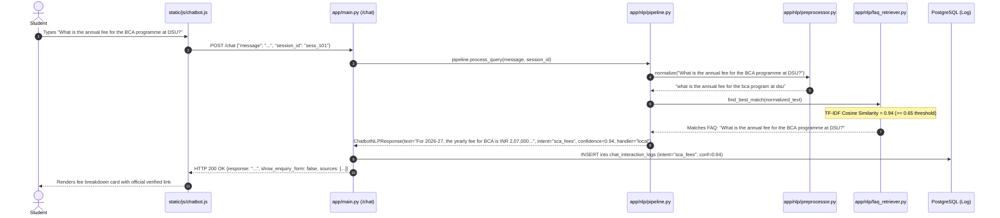
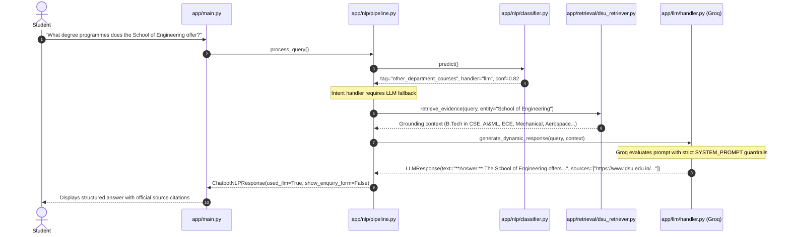
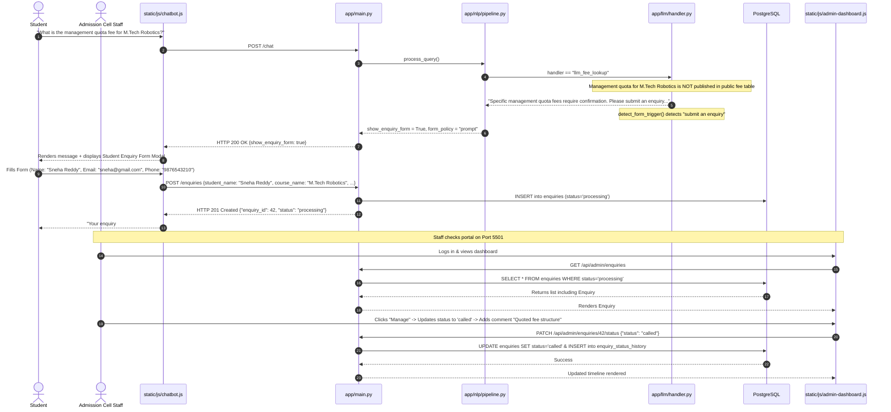

# PART 5: END-TO-END EXECUTION TRACES
## Verifiable Execution Walkthroughs Across Four Real Scenarios

---

### Scenario 1: A Question Answered Locally via Local NLP
**Student Query:** `"What is the annual fee for the BCA programme at DSU?"`

- **Runtime Decision:** The query directly matches a pre-verified entry in `faq_info.json`.
- **Groq LLM Invocation:** **NO.** The system bypasses external API calls entirely, answering with zero cloud latency (<15ms) and zero hallucination risk.

---

### Scenario 2: Different Wording for the Same Intent
**Student Query:** `"How much should I pay for Data Science?"`

1. **Preprocessing (`app/nlp/preprocessor.py`):**
   - `"How much should I pay for Data Science?"` $\rightarrow$ `"how much should i pay for data science"`
2. **Entity Extraction (`app/nlp/entity_extractor.py`):**
   - Matches program catalog: `course_id = "bca_ds"` (BCA in Data Science).
3. **Intent Classification (`app/nlp/classifier.py`):**
   - Pattern vectorizes via `FeatureUnion` (word n-grams + character n-grams).
   - Logistic Regression predicts: `tag = "sca_fees"` with probability `0.88` ($> 0.60$).
4. **Answer Construction (`app/nlp/pipeline.py`):**
   - Matches the extracted entity `bca_ds` with fee schedules in `college_info.json`:
   - *"The annual fee for BCA (Data Science) is INR 2,07,000 per year."*
5. **Why it works despite alternate phrasing:**
   - The TF-IDF model associates phrases like `"how much"`, `"pay"`, and `"fee"` with the `sca_fees` training class.
   - Character n-grams (`char_wb`) ensure robust token matching even if spelling deviates slightly.

---

### Scenario 3: Question Requiring LLM Fallback
**Student Query:** `"What degree programmes does the School of Engineering offer?"`

- **Runtime Decision:** Engineering courses are outside the primary local School of Computer Applications dataset. The classifier detects `other_department_courses` with `handler="llm"`.
- **Safety Control:** The Groq handler receives verified departmental catalog text via `DSURetriever`. It formats the answer into the mandatory 4-part structure (**Answer**, **Key details**, **Official sources**, **Next step**) and appends clickable official links.

---

### Scenario 4: Unsupported Detail Followed by Enquiry Lead Submission
**Student Query:** `"What is the management quota fee for M.Tech Robotics?"`

- **Result:** Complete end-to-end integration: unanswered student question automatically converts into a persistent lead in PostgreSQL, which is immediately actionable by university admission personnel on the staff dashboard.
